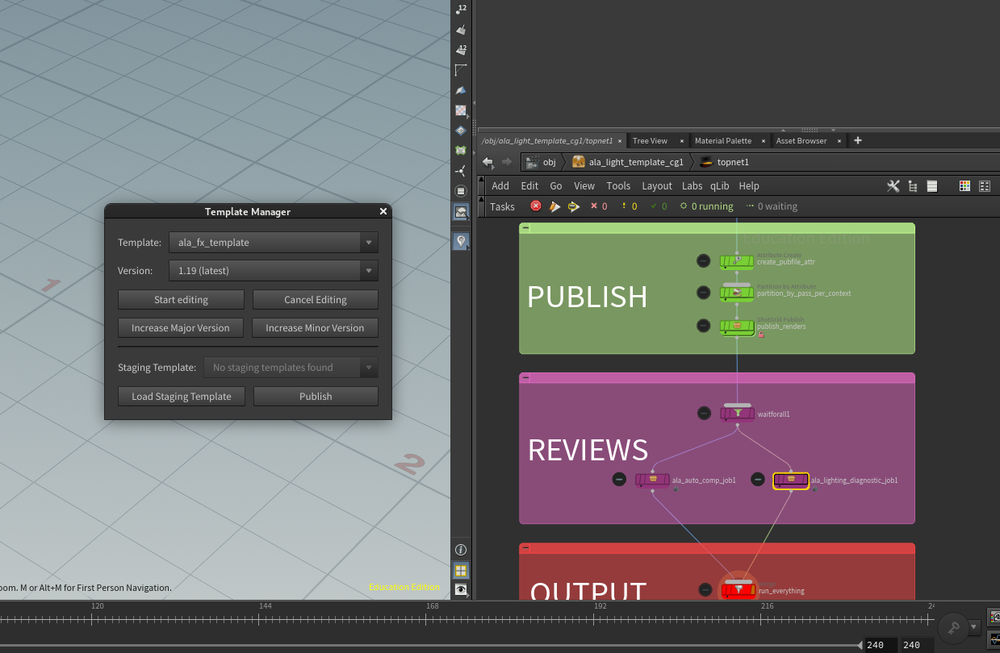
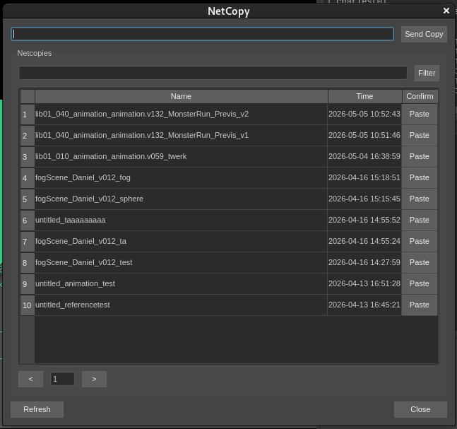
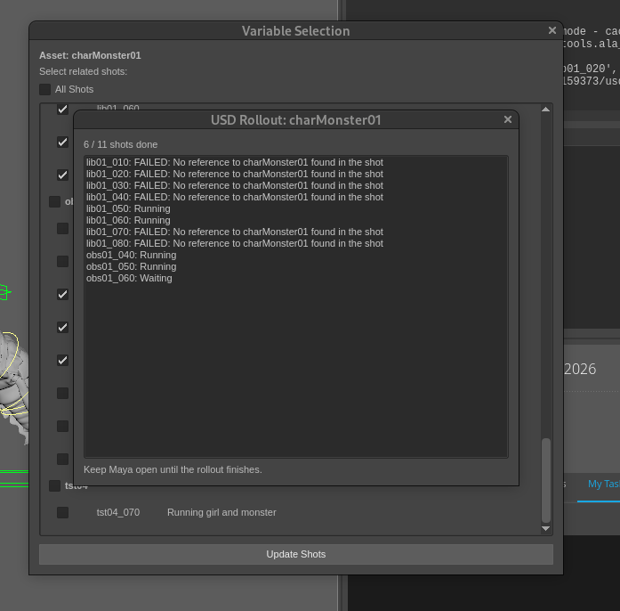
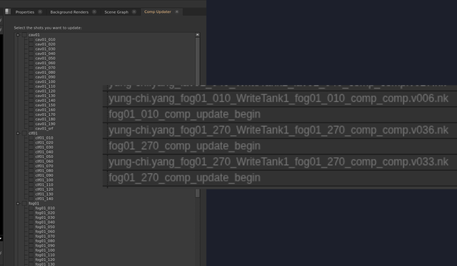
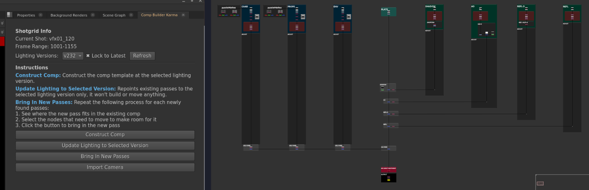
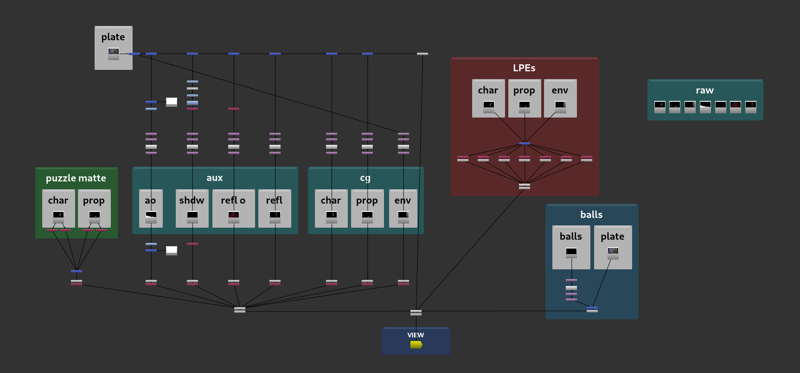
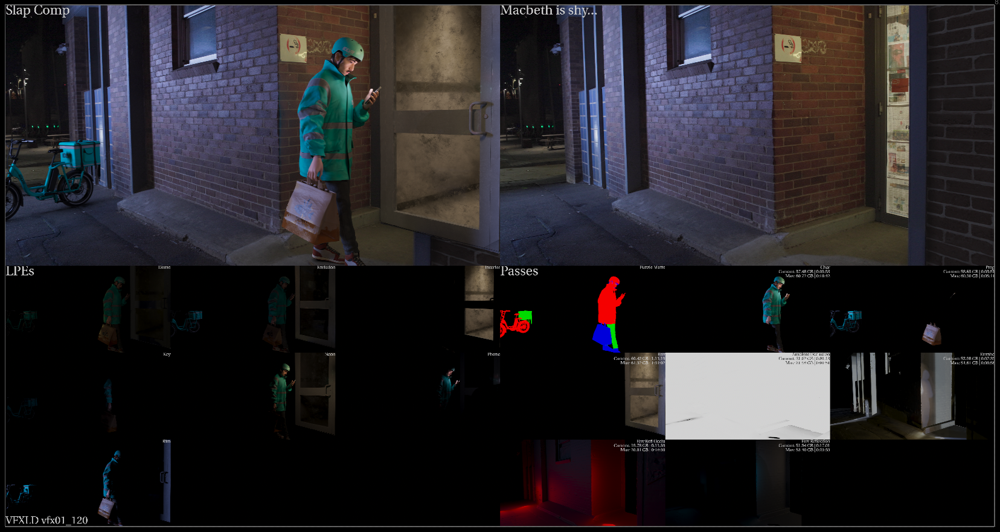
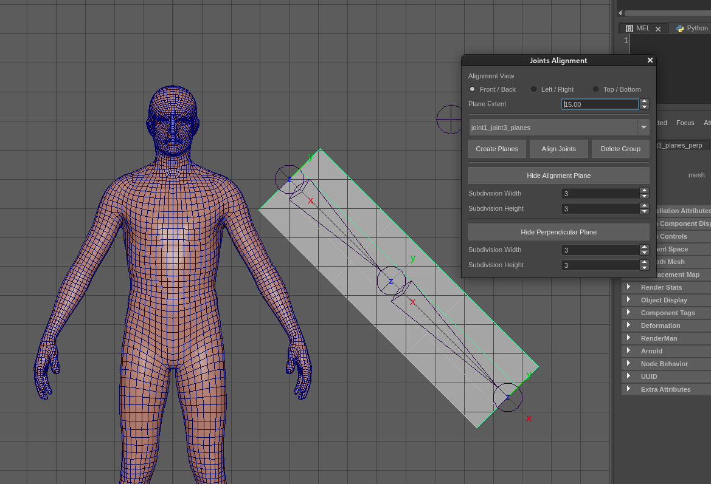
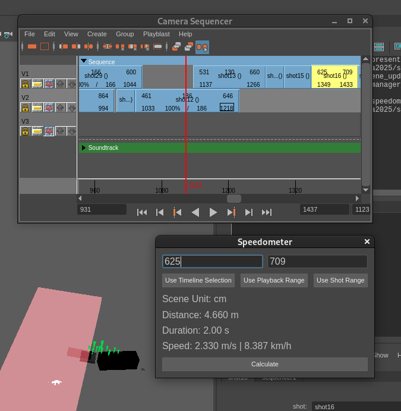
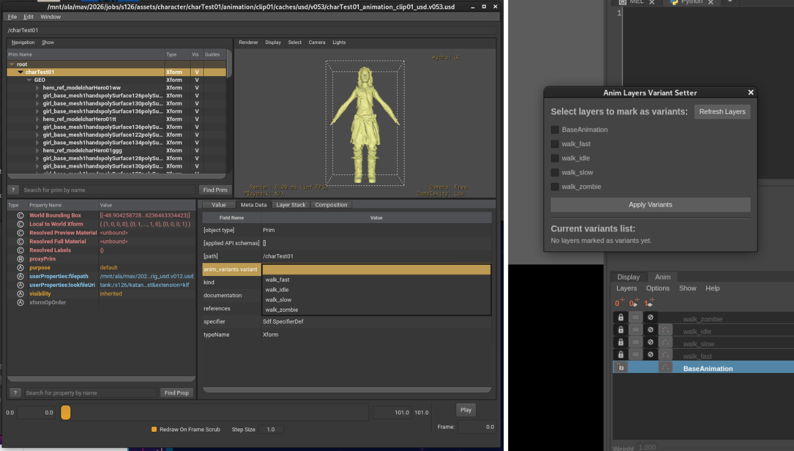

# Projects

- [Pipeline](#pipeline)
- [Compositing](#compositing)
- [Lighting](#lighting)
- [Rigging](#rigging)
- [Animation](#animation)
- [USD](#usd)
- [R&D](#rd)

## Pipeline

### Template Manager 

A tool for updating ALA's shared HDA templates without going through several seperate steps to bump version and release.

_(breakdown)_

### Netcopy  

A shared node-clipboard tool, built with other TDs across multiple DCCs. It lets artists export a set of node selection to share across different machines on the network.

_(breakdown)_

### Anim USD rollout 

This helps streamline the process of updating in anim shots when a new rig version is published.

_(breakdown)_

### Comp Updater 

This tool allows compositors to quickly update and render the selected shots for reviews in dailies. (UI credits to Victor Luong.)

_(breakdown)_

## Compositing

### Comp Builder 

This tool assembles a shot template in Nuke that brings in the render passes and camera.

_(breakdown)_

## Lighting

### Lighting Diagnostics 

Generates a diagnostic graph for lighting review.

_(breakdown)_

### Lighting Template (Technical Support) 

A collaboration with lighters for a student-directed project to make a lighting template in Katana.

_(breakdown)_
_(demo)_

## Rigging

### Joint Alignment Tool 

A tool for riggers to align joints early in the rigging process, so a chain (like a tail or spine) sits flat on one plane and deforms cleanly.

_(breakdown)_

## Previs/Animation

### Speedometer 

Measures how far an animated object travels between two frames and converts that into real-world speed (m/s, km/h), so previs artists and animators can check motion timing against physical reference.

_(breakdown)_

## USD

### Animation Variant Output System 

_(breakdown)_

## R&D

### Gaussian Splat Relighting Environment Bring-up

An exploration around Gaussian Splat relighting. The goal was to get open-source research tools **LumiGauss** ([repo](https://github.com/joaxkal/lumigauss)) and **GI-GS** ([repo](https://github.com/stopaimme/GI-GS)) running on studio hardware and see their capability, which went through a series of debugging and reconfiguration.

_(breakdown)_
_(demo)_
